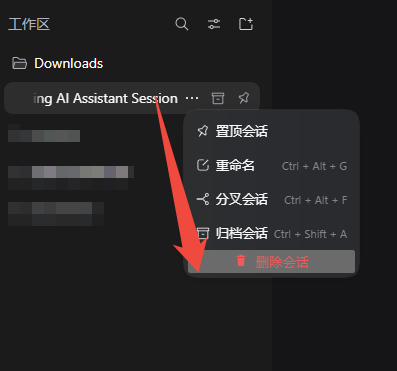
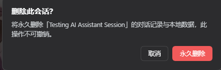
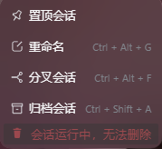

# DeepSeekHarness Session Delete（删除会话）

[](https://dsh-plugin.org/plugins/ansellwan/deepseekharness-session-delete)
[](https://www.npmjs.com/package/dsh-session-clean)
[](https://www.npmjs.com/package/dsh-session-clean)
[](LICENSE)

DSH 有归档、重命名、分叉，却**没有删除会话**。这个插件在侧栏每个会话的 `⋯` 菜单里补上一项红色「删除会话」，点之前先弹确认框。删就是真删：不会给你留个"看起来删了、过两天又冒出来"的尾巴。

  

## 安装

**主测试目标是 DeepSeek Harness 桌面版。** 浏览器形态的 web profile（`dsh web`）按设计应当可用——插件只用到 Web 面 API，没有任何桌面端专属调用——但**未单独实测**；Web 端用户请自行尝试，欢迎反馈结果。

```bash
# 从 npm 安装（推荐）—— 桌面版，已实测的主目标
dsh plugin --profile desktop add dsh-session-clean

# 浏览器形态 profile（dsh web）—— 按设计可用，但未单独实测
dsh plugin --profile web     add dsh-session-clean

# 从 GitHub 安装（桌面版）
dsh plugin --profile desktop add github:Ansellwan/DeepSeekHarness-Session-Delete
```

安装后**重启 DSH**（软件形态没有热刷新；`dsh web` 服务重启进程即可）。

**升级**（add 不会自动升版，须显式版本号）：

```bash
dsh plugin --profile desktop add dsh-session-clean@<新版本号>
```

**卸载**：

```bash
dsh plugin --profile desktop remove dsh-session-clean
```

## 它能做什么

- 每个会话的 `⋯` 菜单里多一项红色「**删除会话**」（排在置顶 / 重命名 / 分叉 / 归档之后）
- 会话正在干活时（回复中，或等你审批 / 回答）**自动变灰**，点不动
- **已归档的会话一样能删**——清库存最好用
- 删除前弹一次确认框，确认后才动手
- 侧栏底部多一个「**清理分组**」入口：选一个分组、看清会话数量、确认一次，整组会话一次删完

## 清理整个分组

清理一个旧项目，往往要把整组对话一条条删掉。侧栏底部的「清理分组」按钮替你一次做完：

1. 列出所有还有会话的分组，**外加一行「未分组」**——它装的是不属于任何分组的会话（删掉分组后遗留下来的、或者新建时没选分组的）
2. 数字与侧栏看到的一致：若该分组还藏着已归档 / 子代理条目，会显示成"2 个会话 · 3 个不在列表"，明确告诉你它们存在、清空时也会一并删除，而不是给你一个对不上号的总数
3. 点「清空」后只弹一次确认，确认框里写明确切数量（"永久删除该分组下的 N 个会话"），并同时提供「清空」（保留分组）与「清空并移除分组」（连分组一起注销）两个选择
4. **组内只要有会话在运行，整批拒绝**——和单会话同一条铁律：只要有一个在回复或等审批/回答，一条都不删，并告诉你几个在忙；绝不偷偷跳过某个成员
5. 执行时显示 `正在删除 i/N`，结束后汇总（"已删除 N 个"或"已删除 N 个，失败 M 个"）
6. 如果主视图正在看的会话也在被删之列，界面会离开它：**切到同一个分组里的新会话**（清的是「未分组」时，切到第一个还存在的分组）

分组本身会保留（DSH 把分组定义为"注册过的文件夹"，不是会话容器）：它会变成一个空分组，可以在里面新建会话，或用官方的「删除工作区」把分组移除。

### 两条“删分组”的路，故意分开

官方「删除工作区」与本插件的面板做的是不同的事，本插件**从不替官方动作做决定**：

| 你做的操作 | 会话 | 分组 |
|---|---|---|
| 官方 **删除工作区** | 保留——下沉到「未分组」 | 注销 |
| 面板 → **清空** | 删除 | 保留，变成一个可以新建会话的空分组 |
| 面板 → **清空并移除分组** | 删除 | 注销 |

所以“把这个项目彻底清掉”是面板里的一个动作：选中分组 → 选「清空并移除分组」→ 确认一次（确认框仍会写明会话数量）。如果只想清掉对话、留着文件夹以后继续用，就选「清空」。

## 删除到底做了什么

1. **数据真的没了，删了找不回来**（和「归档」不一样：归档只是收起来）
2. **正开着的会话也能删**：删完侧栏里立刻就没有它了，不用重启，刷新页面也不会回来；如果删的正是你正在看的那个会话，界面会自动切到同工作区的新会话，不会停在一个已被删除的对话上
3. **万一这次删不彻底**，插件只会先把它藏起来，并且**直接告诉你**——不会假装已经删干净

## 会删掉什么，不会删什么

| | |
|---|---|
| ✅ 会删 | 这段对话本身，它的标题 / 大纲 / token 统计等缓存，工具输出过长时落盘的溢出文件，以及它在侧栏里的各种登记（分组、置顶、归档） |
| ❌ 不动 | `~/.dsh/attachments/` 里的附件原件——它们按内容存一份，多个会话可能共用同一份，按会话删会连累别的对话 |
| ❌ 不动 | 本插件自己的日志（`~/.dsh/logs/session-delete.log`，记录删过谁、删了哪些文件） |
| ❌ 不动 | 其他插件自己抄到各自数据库里的副本 |

另外，DSH 进程退出前，内存里还会留一个空的会话对象（官方没提供清理它的接口）。它不会再出现在任何列表里，重启后彻底消失。

## 常见问题

- **删了还能恢复吗？** 不能。没有回收站，也没有撤销。
- **正在回复的会话能删吗？** 不能，会被拦下并提示原因；等它停下来再删。
- **提示"先藏起来"是什么意思？** 说明当前 DSH 版本不支持彻底移除，插件只能先把它隐藏，并如实告诉你；这一行会在**重启 DSH 后彻底消失**。插件宁可说清楚，也不会假装删成功。
- **删的时候正在看这个会话怎么办？** 能删，但删完窗口会空着，点开别的会话即可。
- **会误删别的会话吗？** 不会。只动这一个会话自己的文件。
- **删完要不要重启才生效？** 不用。
- **会联网吗？** 不会，没有任何网络请求、没有遥测。

## 权限与隐私

- 只在你自己的 DSH 进程里开一个**仅本机**可用的接口，并走 DSH 官方同一道连接信任检查，外部连不进来
- 只删这一个会话自己的文件：`~/.dsh/sessions/…`、`~/.dsh/storages/session_projcache/…`，以及临时目录里属于它的溢出文件目录
- 无网络请求、无遥测、无外部服务

## 兼容性

| | |
|---|---|
| DeepSeek Harness | 桌面版 `0.2.0-rc.2` —— 已实测的主目标 |
| Profile | **desktop：已实测、正式支持。** Web 形态 profile（`dsh web` 浏览器形态）：按设计可用（只用到 Web 面 API，无桌面端专属调用），但**未单独实测——请自行尝试并反馈遇到的问题** |
| Node | ≥ 18（DSH 运行时自带） |
| 能力分类 | 界面与体验 |

## 技术说明（普通用户可跳过）

- **客户端半** `client.js`：向官方 slot 列表 `sidebar.workspaces.session.menu.item` 注册 `order: 500` 的菜单行（与内置 pin=100 / rename=200 / fork=300 / archive=400 同一列表，官方支持的扩展点）；忙碌状态来自宿主注入的 `useSessionStatus` 快照；确认弹窗挂在框架级 `shell.overlay` 槽位，菜单关闭不会连带销毁。
- **宿主半** `index.js`：注册私有路由 `/_dsh-session-clean`，先重探会话活动，再按固定顺序删除——① 把仍驻留内存的会话从宿主活动存储中卸载 → ② 从工作区注册表移除（全局归档 / 置顶集 + 各工作区会话列表）→ ③ 清理落盘数据（会话目录、`session_projcache` 投影缓存记录、spill 溢出目录）。注册表写入走它自己已打开的同一个存储域句柄，写即持久化并发变更事件，侧栏据此刷新。
- **卸载活会话**用的是框架自己的拆除原语 `SessionStore.liveEntryFor(session).detach()`（即属主卸载时执行的同一段 `store.delete` + `session/disposed`）。该事件被会话控制器转成 `api-session/removed`，客户端据此**真的把那一行删掉**，同时关闭该会话的日志写入器，因此对话记录不会被重新落盘。`liveEntryFor` / `detachEntered` 属于内部成员（不在生成的 API catalog 里），所以每一步都先做能力探测，失败就退化为「如实汇报的隐藏」，不做无声的假删除。
- **投影缓存为什么必须单独处理**：它是「写回型自愈缓存」，且该域真正的表名是 `sessions`、键是完整会话 id。必须通过活动域删键（而不是只删文件），否则域内存里的那行还在，下一次检查点就会把文件重新写出来。
- 不修改 `app.asar`，不 patch 任何官方装载行，升级 DSH 不受影响。

## 许可证

MIT
